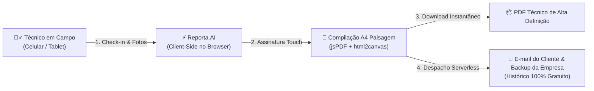

# Reporta.AI ⚡
### Plataforma SaaS Serverless para Relatórios Técnicos de Campo em A4 Paisagem


---

## 📌 Visão Geral do Projeto

O **Reporta.AI** é uma plataforma ágil, autônoma e serverless (`HTML5 + Tailwind CSS + Vanilla JS`) desenvolvida para digitalizar rotinas de vistoria e transformar atividades de campo em relatórios técnicos de alto padrão corporativo.

Projetada para atender com excelência desde **prestadores de serviços em geral** até **engenheiros, eletrotécnicos e equipes de manutenção predial e industrial**, a ferramenta elimina o retrabalho administrativo ao consolidar Ordens de Serviço (O.S.), auditoria fotográfica de *"antes e depois"* e coleta de assinaturas digitais em PDFs executivos no padrão A4 Paisagem — prontos para emissão e entrega direta no local de atendimento.

A aplicação opera **100% no navegador (Client-Side)** com arquitetura serverless para despacho e arquivamento automatizado por e-mail, dispensando servidores dedicados, bancos de dados relacionais e custos recorrentes de infraestrutura.

### 🔄 Fluxo Operacional


### 🎯 Problema vs. Solução
- **Sem o Reporta.AI:** Fotos perdidas no WhatsApp, pranchetas de papel amassadas, horas perdidas à noite digitando relatórios no Word/Excel e atraso no faturamento do serviço.
- **Com o Reporta.AI:** Documentação padronizada no ato da vistoria, fotos etiquetadas com tags coloridas (*Antes/Depois*), aceite do cliente coletado na tela via assinatura touch e envio imediato do PDF por e-mail.

---

## 🚀 Principais Funcionalidades

1. **Personalização Dinâmica de Identidade Visual:**
   - Upload de logotipo da contratada com preview em tempo real.
   - Compressão client-side em canvas para evitar lentidão ou estouro de memória.
   - Armazenamento automático no `localStorage` do navegador (a empresa preenche seus dados cadastrais uma única vez).
   - Dados editáveis: Razão Social, CNPJ, Telefone, E-mail, Registro CREA/CFT e Endereço da Sede.

2. **Gestão Completa de O.S. e Cliente:**
   - Gerador de número de Ordem de Serviço em 1 clique (`OS-YYYY-XXXX`).
   - Seletor de Tipo de Tarefa: Preventiva, Corretiva, Preditiva (Termografia), Comissionamento, Laudo NR-10/NBR 5410.
   - Botão para carimbagem automática de data e hora atual (Check-in e Check-out).
   - Endereço da intervenção e escopo técnico solicitado.

3. **Relato Técnico de Execução & Fotos ("Antes e Depois"):**
   - Criação dinâmica de múltiplos blocos de demandas/atividades técnicas.
   - Upload múltiplo de fotos com etiquetagem automática e customizável:
     - 🔴 **ANTES**
     - 🟡 **DURANTE**
     - 🟢 **DEPOIS**
     - 🔵 **EVIDÊNCIA**
   - Campo de legenda individual por foto e parecer técnico por subsistema.

4. **Geração de PDF Corporativo em A4 Paisagem (Landscape):**
   - Diagramação rigorosa seguindo o padrão de grandes multinacionais e empreiteiras de engenharia elétrica (como Espiral Engenharia).
   - Dimensões exatas de A4 Paisagem: `297mm x 210mm`.
   - Paginação automática inteligente: nunca corta fotos ou tabelas ao meio.
   - Quadro de Assinatura Digital dupla (Técnico Líder e Aceite do Cliente) com suporte a touch screen em smartphones e tablets.
   - Pré-visualização modal interativa com navegação de páginas antes de imprimir ou baixar.

5. **Estratégia Serverless de Envio e Armazenamento via E-mail:**
   - **Opção A - Vercel Serverless Function (`/api/send-email.js`):** Envia o PDF compilado em alta resolução como anexo de e-mail real utilizando a API da Resend (100% gratuito).
   - **Opção B - EmailJS (Client-Side):** Permite disparar e-mails diretamente do navegador com resumo executivo para arquivamento histórico na caixa de entrada sem precisar de backend.
   - **Opção C - Cliente Local (Mailto):** Abre o Outlook ou Gmail nativo do dispositivo já preenchido para envio rápido com o PDF baixado.

---

## ⏱️ Guia de Deploy Gratuito na Vercel em Menos de 5 Minutos

Você pode colocar o **Reporta.AI** em produção e obter uma URL pública segura com SSL (`https://seu-app.vercel.app`) de forma 100% gratuita seguindo um dos métodos abaixo:

### Método 1: Pelo Navegador (Sem Instalar Nada) - Mais Fácil

1. Acesse **[vercel.com](https://vercel.com)** e crie uma conta gratuita (ou faça login com seu GitHub).
2. Se o seu projeto estiver em um repositório no GitHub:
   - Clique em **"Add New..."** ➔ **"Project"**.
   - Selecione o repositório `Reporta.AI` e clique em **"Import"**.
   - A Vercel detectará automaticamente que é um projeto estático (`Framework Preset: Other`).
   - Clique em **"Deploy"**.
3. Em menos de 30 segundos sua URL estará ativa!

> **Dica para Anexo PDF Automático via Resend:**
> No painel da Vercel, acesse: **Settings ➔ Environment Variables** e adicione a variável:
> - **Key:** `RESEND_API_KEY`
> - **Value:** `sua_chave_resend_aqui` (obtida gratuitamente em [resend.com](https://resend.com)).

---

### Método 2: Pelo Terminal via Vercel CLI (Desenvolvedores)

1. Abra o terminal (PowerShell ou Bash) na pasta do projeto:
   ```bash
   cd c:\Users\ednar\OneDrive\Documentos\Reporta.AI
   ```

2. Instale a Vercel CLI globalmente (se ainda não tiver):
   ```bash
   npm install -g vercel
   ```

3. Execute o comando de deploy:
   ```bash
   vercel
   ```
   - Pressione `Enter` para confirmar as opções padrão:
     - Set up and deploy? `y`
     - Which scope do you want to deploy to? `Seu usuário`
     - Link to existing project? `n`
     - What's your project's name? `reporta-ai`
     - In which directory is your code located? `./`

4. Para publicar em produção direta:
   ```bash
   vercel --prod
   ```

---

## 🛠️ Tecnologias Utilizadas

- **HTML5 & Vanilla JavaScript ES6+:** Arquitetura limpa, sem overhead de frameworks ou builds complexos.
- **Tailwind CSS (CDN):** Estilização corporativa moderna com paleta de engenharia (Slate, Amber, Emerald, Sky).
- **jsPDF (v2.5.1):** Motor de compilação de documentos em formato A4 Paisagem.
- **html2canvas (v1.4.1):** Renderizador vetorial e rasterizador de alta fidelidade para geração de evidências.
- **Lucide Icons:** Conjunto de ícones vetoriais leves.
- **EmailJS / Resend API:** Disparo de notificações e arquivamento serverless.

---

## 📄 Estrutura de Arquivos

```text
Reporta.AI/
├── index.html         # Aplicação completa (UI + Lógica + Estilos + jsPDF)
├── vercel.json        # Configuração de roteamento e headers de segurança
├── README.md          # Documentação e guia de uso
└── api/
    └── send-email.js  # Serverless Function da Vercel para envio de e-mails com anexo PDF
```

---

*Desenvolvido com foco em agilidade, produtividade e conformidade técnica para operações de engenharia de campo.*

